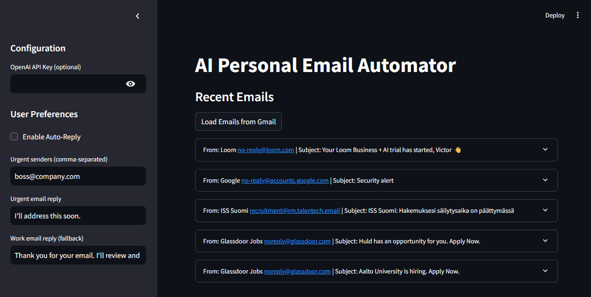

# AI Email Automator

[](https://github.com/drbetique/ai-email-automator/actions/workflows/ci.yml)

A small Streamlit app that reads your recent Gmail messages, sorts them into **urgent**, **work**, **social** or **spam**, and suggests a reply that you can send with one click. It works with no API key using a rule-based classifier, and can use an OpenAI model for better classification and replies.



## Features

- **Classification** into `urgent`, `work`, `social` and `spam`, with a one-line reason for each.
- **Urgent senders**: addresses you list are always treated as urgent.
- **Suggested replies**, which you review before anything is sent. Nothing is sent automatically.
- **Rule-based fallback**: whole-word keyword matching, used when no key is set or the model call fails.
- **Optional OpenAI**: set a key and the model classifies and drafts replies.
- **Sends through Gmail** with the `gmail.send` scope, only when you press the button.

## Privacy

- **Without an OpenAI key**, everything runs on your machine. Email is only exchanged with Google's Gmail API.
- **With an OpenAI key**, the sender, subject and first 1,000 characters of each email you view are sent to OpenAI to classify it and draft a reply. Do not enable it for mail you would not send to a third party.
- Your Gmail OAuth token is stored locally in `token.pickle` and your client file in `credentials.json`. Both are git-ignored. Never commit them.

## Setup

Requires Python 3.10 or newer.

```bash
git clone https://github.com/drbetique/ai-email-automator.git
cd ai-email-automator
python -m venv .venv
source .venv/bin/activate        # Windows: .venv\Scripts\activate
pip install -r requirements.txt
```

### Gmail API credentials

1. In the [Google Cloud console](https://console.cloud.google.com/), create a project and enable the **Gmail API**.
2. Configure the OAuth consent screen and add yourself as a test user.
3. Create an **OAuth client ID** of type *Desktop app* and download it.
4. Save the file as `credentials.json` next to `app.py`.

The first time you press *Load Emails from Gmail* a browser window asks you to approve read and send access.

### Optional: OpenAI

Paste a key into the sidebar, or set it before starting the app:

```bash
export OPENAI_API_KEY=...        # PowerShell: $env:OPENAI_API_KEY="..."
export OPENAI_MODEL=gpt-4o-mini  # optional, this is the default
```

### Run

```bash
streamlit run app.py
```

Use *Use Sample Email* to try it without Gmail.

## Tests

```bash
pip install pytest
python -m pytest
```

The tests fake the Gmail and OpenAI clients, so they need no credentials, key or network.

## Roadmap

- [ ] Implement Mark as spam and Archive with the Gmail `modify` scope, and ask for that scope only when needed.
- [ ] Store the OAuth token in the operating system's keyring instead of a pickle file.
- [ ] Remember the classification so the model is not called again on every Streamlit rerun.
- [ ] Let the user choose how many emails to load and which label to read.
- [ ] Drop the quoted reply history before sending text to the model.
- [ ] Support a local model so no email text has to leave the machine.
- [ ] Deploy a demo that uses sample emails only.

## Licence

MIT, see [LICENSE](LICENSE).
